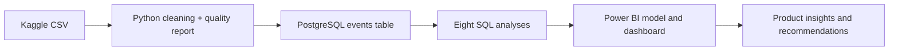

# ProductPulse – User Engagement & Conversion Analytics

ProductPulse is an end-to-end analytics portfolio project built around public historical e-commerce event data. It demonstrates data validation, a repeatable Python-to-PostgreSQL pipeline, product KPIs, session funnels, and a Power BI handoff.

## Business questions

How does observed daily/monthly activity change? Which products and categories draw views? What share of identified sessions progresses from view to cart and purchase? What recorded purchase value appears by category and date? The analysis uses user, event, and session denominators explicitly.

## Architecture



## Dataset and attribution

Source: [eCommerce events history in electronics store](https://www.kaggle.com/datasets/mkechinov/ecommerce-events-history-in-electronics-store), published on Kaggle by Michael Kechinov. The provided `data/raw/events.csv` has 885,129 rows and the expected nine columns (`event_time`, `event_type`, `product_id`, `category_id`, `category_code`, `brand`, `price`, `user_id`, `user_session`). Before redistributing the raw file, verify the dataset page's current license and terms; the Kaggle page's license was not readable to the setup process. Raw data is ignored by Git.

## Data and analytics

`scripts/clean_data.py` parses UTC timestamps, validates event types/identifiers/prices, preserves missing category, brand, and session values, and reports exact duplicate rows without discarding them. It emits a JSON data-quality report. The PostgreSQL `events` table uses a generated technical key and indexes used by the analyses. SQL files cover DAU, monthly activity and endpoint stickiness, product engagement, chronological session funnel, observed cart abandonment, category/brand performance, repeat sessions, and purchase value trends. Definitions and limits are in [KPI_DEFINITIONS.md](docs/KPI_DEFINITIONS.md).

## Setup (WSL Ubuntu)

```bash
python3 -m venv .venv
source .venv/bin/activate
pip install -r requirements.txt
cp .env.example .env
# Edit the local password, then export these variables:
set -a; source .env; set +a
```

If starting from a fresh clone, configure the Kaggle API credentials (`~/.kaggle/kaggle.json`, mode 600), install Kaggle CLI, then run:

```bash
pip install kaggle
python scripts/download_data.py
```

The supplied CSV is already present in this workspace. Clean and validate it:

```bash
python scripts/clean_data.py
python scripts/validate_data.py
```

Start PostgreSQL and run analyses:

```bash
docker compose up -d --wait
python scripts/load_data.py
python scripts/validate_data.py --database
psql "$DATABASE_URL" -f sql/validation.sql
python scripts/run_analytics.py
pytest -q
```

Generated quality JSON and query CSVs live under `reports/generated/` and are not committed. Docker Compose initializes the schema on the first volume creation. If changing schema after initialization, apply `psql "$DATABASE_URL" -f sql/schema.sql` or recreate the local volume deliberately.

## Power BI

Power BI Desktop is not available in WSL, so no fake `.pbix` is included. Follow [POWER_BI_SETUP.md](powerbi/POWER_BI_SETUP.md), use the DAX in `powerbi/measures.dax`, and review [data_model.md](powerbi/data_model.md). Make a date-only relationship and do not apply event-type filters to funnel metrics.

## Current environment status

The full CSV was cleaned, loaded, and validated in PostgreSQL: 885,129 rows, 407,283 distinct users, and 490,398 non-null sessions. All SQL analyses executed and exported CSV results under `reports/generated/sql/`; the five fixture tests pass. Power BI Desktop was unavailable in WSL, so assembling and validating the `.pbix` remains a manual step. `reports/product_insights.md` summarizes database-backed findings and their limitations.

## Limitations and next steps

This source contains observed events only: no reliable signup date, order identifier, acquisition channel, refund, inventory, customer demographics, or financial reconciliation. Recorded purchase value is the sum of prices on purchase events, not verified revenue. Session journeys may be incomplete or cross product. The repeat-session metric is not cohort retention. Next, inspect the generated result CSVs, assemble the Power BI page, and discuss recommendations as hypotheses.

## Credits

Dataset attribution: Michael Kechinov, via Kaggle. All analytical conclusions must be tied to generated outputs and their time window.
